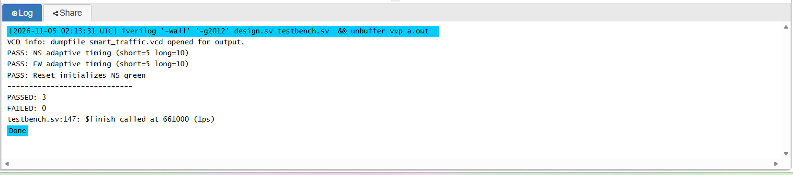
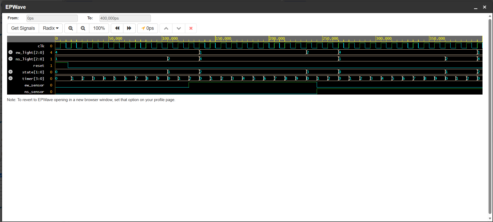

# Smart Traffic Light Controller Using Verilog and FSM

A vehicle-sensor-responsive traffic light controller designed using Verilog HDL and a Finite State Machine (FSM).

The system controls traffic at a two-direction intersection and adjusts green-light duration based on vehicle detection.

The design was simulated using Icarus Verilog on EDA Playground and verified using an automated testbench and EPWave waveform analysis.

## Project Overview

Traditional fixed-timer traffic lights change at predetermined intervals, regardless of traffic demand.

This project demonstrates a simple adaptive approach using two vehicle sensor inputs:

- `ns_sensor` — detects a vehicle waiting on the North-South road.
- `ew_sensor` — detects a vehicle waiting on the East-West road.

The controller uses these inputs to determine when to transition between traffic light states.

## Features

- Four-state Finite State Machine (FSM)
- Vehicle-sensor-responsive traffic control
- North-South and East-West traffic light outputs
- Minimum and maximum green-light durations
- Automatic transitions between green and yellow
- Clock-based timing using a 4-bit counter
- Asynchronous reset
- Protection against simultaneous green signals
- Automated Verilog testbench
- Waveform simulation using EPWave

## FSM State Diagram

The controller operates through four states:

```text
       +-------------------+
       |                   |
       v                   |
  S0: NS GREEN             |
       |                   |
       v                   |
  S1: NS YELLOW            |
       |                   |
       v                   |
  S2: EW GREEN             |
       |                   |
       v                   |
  S3: EW YELLOW -----------+
```

State transitions occur according to the internal timer and vehicle sensor inputs.

## State Table

| State | North-South | East-West | Description |
|-------|-------------|-----------|-------------|
| S0 | Green | Red | North-South traffic moves |
| S1 | Yellow | Red | North-South transition |
| S2 | Red | Green | East-West traffic moves |
| S3 | Red | Yellow | East-West transition |

Traffic light encoding:

| Color | Binary |
|-------|--------|
| Red | `100` |
| Yellow | `010` |
| Green | `001` |

## Adaptive Vehicle-Sensor Control

The controller adjusts green-light duration depending on whether vehicles are waiting on the opposite road.

### North-South Green (S0)

- North-South receives green.
- The controller maintains green for a minimum of 5 clock cycles.
- If `ew_sensor = 1`, the controller transitions to yellow after the minimum green period.
- If no East-West vehicle is detected, green continues until the maximum duration of 10 clock cycles.

### East-West Green (S2)

- East-West receives green.
- The controller maintains green for a minimum of 5 clock cycles.
- If `ns_sensor = 1`, the controller transitions to yellow after the minimum green period.
- If no North-South vehicle is detected, green continues until the maximum duration of 10 clock cycles.

### Yellow States (S1 and S3)

Yellow states use a fixed timer threshold before moving to the next state.

### Safety

The controller assigns red to both directions by default and activates green for only one direction in each valid state.

This prevents both directions from receiving green simultaneously during normal operation.

## Hardware Design

The Verilog module contains:

- `clk` — clock input
- `reset` — asynchronous reset input
- `ns_sensor` — North-South vehicle sensor
- `ew_sensor` — East-West vehicle sensor
- `ns_light[2:0]` — North-South traffic light output
- `ew_light[2:0]` — East-West traffic light output

Internal components:

- 2-bit FSM state register
- 4-bit timing counter
- Sequential state transition logic
- Combinational traffic light output logic

## Verification

The project was tested using Icarus Verilog and an automated Verilog testbench.

### Adaptive Timing Tests

| Test | Expected | Result |
|------|----------|--------|
| NS green with EW vehicle waiting | 5 cycles | PASS |
| NS green without EW vehicle waiting | 10 cycles | PASS |
| EW green with NS vehicle waiting | 5 cycles | PASS |
| EW green without NS vehicle waiting | 10 cycles | PASS |
| Reset initializes NS green | NS Green / EW Red | PASS |

The four timing scenarios are grouped into two adaptive timing checks.

### Automated Test Results

```text
PASS: NS adaptive timing (short=5 long=10)
PASS: EW adaptive timing (short=5 long=10)
PASS: Reset initializes NS green
-----------------------------
PASSED: 3
FAILED: 0
```

The testbench also monitors for simultaneous green signals during simulation.

These tests verify the demonstrated scenarios, not every possible sensor sequence or hardware fault.

## Simulation Screenshots

### Adaptive Timing Test Results



### Adaptive Traffic Light Waveform



The waveform demonstrates:

- Clock pulses
- Reset behavior
- FSM state transitions
- Timer counting and resetting
- North-South and East-West traffic light outputs
- Vehicle sensor input changes

## Project Files

| File | Description |
|------|-------------|
| `traffic_fsm.v` | Verilog FSM and vehicle-sensor-based traffic controller |
| `traffic_fsm_tb.v` | Automated verification testbench |
| `Traffic_FSM_Adaptive_Tests_Passed.png` | Adaptive timing verification results |
| `Traffic_FSM_Adaptive_Waveform.png` | EPWave simulation waveform |
| `README.md` | Project documentation |

## How to Run

### Option 1: EDA Playground

1. Open https://www.edaplayground.com/
2. Select Verilog/SystemVerilog.
3. Choose Icarus Verilog as the simulator.
4. Copy `traffic_fsm.v` into the Design panel.
5. Copy `traffic_fsm_tb.v` into the Testbench panel.
6. Enable EPWave.
7. Click Run.
8. Review the test results and waveform.

### Option 2: Run Locally

Install Icarus Verilog and run:

```bash
iverilog -g2012 -o traffic_sim traffic_fsm.v traffic_fsm_tb.v
vvp traffic_sim
```

The testbench generates a `smart_traffic.vcd` waveform file.

This file can be opened using a compatible waveform viewer.

## Skills Demonstrated

- Verilog Hardware Description Language (HDL)
- Digital logic design
- Finite State Machine design
- Sequential and combinational circuits
- Clock-driven counters and timing control
- Sensor-based control logic
- Hardware simulation
- Automated testbench development
- Functional verification
- Waveform analysis
- Debugging and troubleshooting
- GitHub project documentation

## Future Improvements

Potential extensions include:

- Pedestrian crossing requests
- Emergency vehicle priority
- Variable traffic demand-based timing
- Additional traffic lanes
- FPGA hardware implementation
- Real vehicle sensors
- More comprehensive automated verification

## Development Status

**Status: Functional simulation prototype**

The sensor-responsive FSM has been implemented and successfully tested in simulation.

The project has not yet been deployed on physical traffic control hardware.

## Author

Aayan Raza

BEng (Hons) Robotics, Autonomous and Interactive Systems

Heriot-Watt University, Edinburgh

GitHub: https://github.com/aayanr757-web
