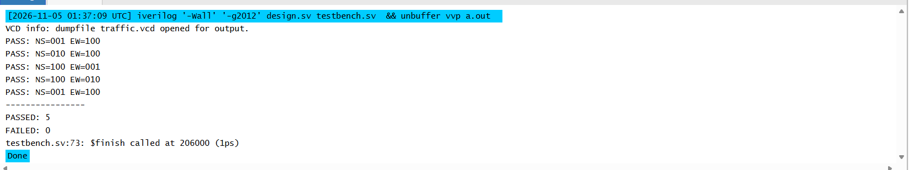
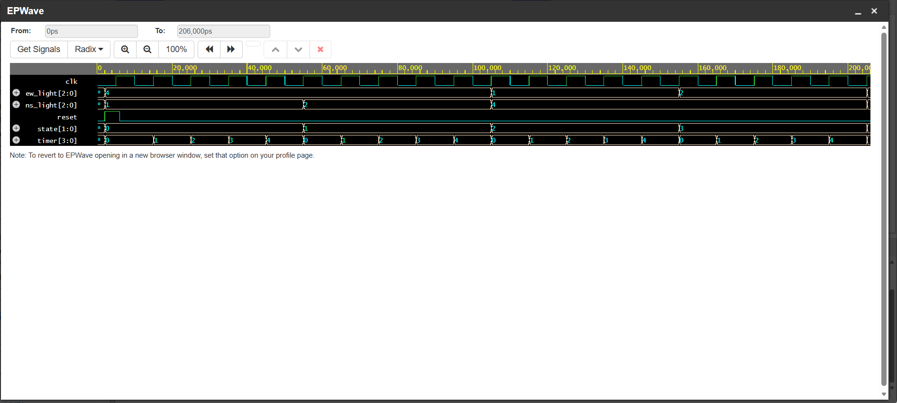

# Smart Traffic Light Controller | Verilog FSM

A four-state traffic light controller designed using Verilog HDL and a Finite State Machine (FSM).

## Project Overview

This project simulates a traffic light controller for two intersecting roads:

- North–South (NS)
- East–West (EW)

The controller uses a clock, reset signal, and timer to automatically switch between traffic light states.

## FSM State Diagram

S0 → S1 → S2 → S3 → S0

| State | North–South | East–West |
|---|---|---|
| S0 | Green | Red |
| S1 | Yellow | Red |
| S2 | Red | Green |
| S3 | Red | Yellow |

Each state lasts five clock cycles before transitioning to the next state.

## Features

- Four-state Finite State Machine
- Synchronous state transitions
- Asynchronous reset
- Clock-based timer
- Two-direction traffic light control
- Automated testbench verification
- Waveform simulation using EPWave

## Verification

## Adaptive Vehicle-Sensor Control

The controller uses North-South and East-West vehicle
sensors to adjust green-light duration.

- Minimum green duration: 5 clock cycles
- Maximum green duration: 10 clock cycles
- Opposite-road vehicle requests can shorten green time
- Four-state finite state machine

## Verification Results

- North-South adaptive timing: PASS
- East-West adaptive timing: PASS
- Reset functionality: PASS
- Total: 3 passed, 0 failed

Simulation performed using Icarus Verilog on EDA Playground.

**Results: 5 tests passed, 0 failed.**

## Simulation Screenshots

### Test Results

### FSM Waveform

## Project Files

- `traffic_fsm.v` — FSM controller implementation
- `traffic_fsm_tb.v` — Simulation testbench
- `Traffic_FSM_5_Tests_Passed.png` — Test results
- `Traffic_FSM_Waveform.png` — Timing waveform

## Skills Demonstrated

Verilog HDL, Finite State Machines (FSM), sequential logic, digital system design, clock-based counters, simulation, functional verification, and waveform analysis.
